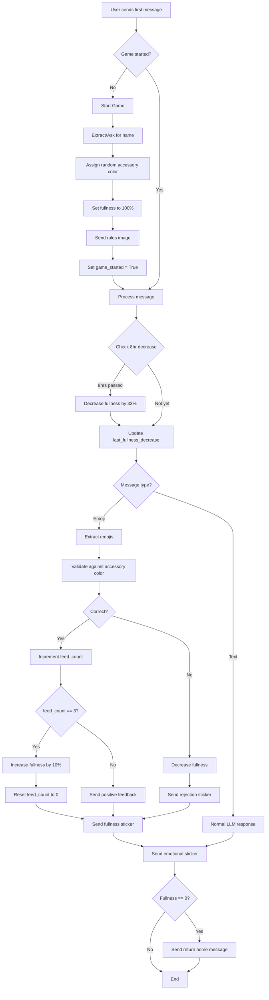

# Implement Feeding Game Logic for Maraschino Cherry Bottle

## Overview

Implement a feeding game mechanic where:

- Users name their character on first message
- Bottle has fullness level (0-100%) that decreases 33% every 8 hours
- Users feed emojis based on accessory color (GREEN/YELLOW/BLACK/BLUE) matching recycling categories
- Need 3 correct emojis to increase fullness by 10%
- Visual feedback via fullness stickers and emotional stickers
- When empty, bottle wants to "return home" (special message/sticker)

## Database Schema Changes

### File: `db/db.py`

**Bottle Model - Add new columns:**

```python
# Add to Bottle class (after line 39):
fullness_level = Column(Float, default=100.0, nullable=False)  # 0.0 to 100.0
accessory_color = Column(String, nullable=True)  # "GREEN", "YELLOW", "BLACK", "BLUE"
last_fullness_decrease = Column(DateTime, nullable=True)  # Track last 8hr decrease
game_started = Column(Boolean, default=False, nullable=False)  # Has game started?
current_feed_count = Column(Integer, default=0, nullable=False)  # Correct emojis in current session (0-3)
last_feed_time = Column(DateTime, nullable=True)  # When last fed
```

**Migration script needed:** `scripts/migrate_add_feeding_game_fields.py`

## Game Logic Functions

### File: `state_logic.py` (or new `game_logic.py`)

**1. Game Initialization:**

- `start_game(session, bottle, user_message)` - Initialize game, extract name, assign random accessory color, set fullness to 100%
- `assign_accessory_color()` - Randomly assign GREEN/YELLOW/BLACK/BLUE
- `send_game_rules(base_url)` - Send rules image from `Rule/regles du jeu.png`

**2. Fullness Management:**

- `check_and_decrease_fullness(session, bottle)` - Check if 8 hours passed, decrease by 33% if needed
- `get_fullness_state(fullness_level)` - Returns "full" (100%), "2/3" (67-99%), "1/3" (34-66%), "empty" (0-33%)
- `update_fullness_after_feed(bottle, is_correct)` - Increase by 10% if 3 correct emojis fed, decrease if wrong

**3. Emoji Feeding:**

- `extract_emojis_from_message(content)` - Extract all emojis from user message
- `validate_emoji_for_color(emoji, accessory_color)` - Check if emoji matches color using `emoji_segmentation_corrected.json`
- `process_emoji_feed(session, bottle, emojis)` - Process feeding logic, update fullness, reset feed count

**4. Sticker Selection:**

- `get_fullness_sticker(accessory_color, fullness_state, base_url)` - Select appropriate fullness sticker from `feeding_game_logic_stickers/`
- `get_emotional_sticker(mood, base_url)` - Select emotional sticker from `stickers/` based on mood
- `get_stickers_for_state(bottle, base_url)` - Returns both fullness and emotional stickers

## Integration Points

### File: `endpoint/endpoint.py`

**1. Game Start Detection (around line 395-400):**

- Check if `bottle.game_started == False` on first message
- Call `start_game()` function
- Extract name from user message or prompt for name
- Send rules image
- Assign accessory color and initialize fullness

**2. Message Processing (around line 450-500):**

- Detect emoji messages using existing `classify_message_type()`
- If emoji message and game started, call `process_emoji_feed()`
- Check fullness decrease before processing: `check_and_decrease_fullness()`

**3. Sticker Sending (around line 1056-1095):**

- After processing feed, send appropriate fullness sticker
- Send emotional sticker based on mood
- If empty state, send special "return home" message/sticker

**4. Response Generation:**

- Modify LLM prompts to include game context (fullness level, accessory color, feed status)
- Include feedback about correct/incorrect feeds

## Sticker Organization

### File Structure Understanding:

- `feeding_game_logic_stickers/` - Contains stickers named: `{color}_bouteille_affamee_{category}_{fullness_state}.webp`
  - Colors: `vert`, `jaune`, `noir`, `bleu`
  - Categories: `verre`, `plastique`, `non_recyclable`, `papier_carton`
  - States: `pleine`, `deux_tiers_plein`, `un_tiers_plein`, `vide`
- `stickers/` - Emotional stickers: `happy_cherry.webp`, `angry_cherry.webp`, etc.

### Sticker Selection Logic:

```python
def get_fullness_sticker(accessory_color, fullness_state, base_url):
    color_map = {"GREEN": "vert", "YELLOW": "jaune", "BLACK": "noir", "BLUE": "bleu"}
    category_map = {"GREEN": "verre", "YELLOW": "plastique", 
                    "BLACK": "non_recyclable", "BLUE": "papier_carton"}
    state_map = {"full": "pleine", "2/3": "deux_tiers_plein", 
                 "1/3": "un_tiers_plein", "empty": "vide"}
    
    filename = f"{color_map[accessory_color]}_bouteille_affamee_{category_map[accessory_color]}_{state_map[fullness_state]}.webp"
    # Return sticker info dict with URL
```

## Emoji Segmentation Integration

### File: Load `emoji_segmentation_corrected.json`

- Load JSON at startup or on first use
- Create lookup function: `get_emoji_category(emoji_char)` - Returns "GREEN", "YELLOW", "BLACK", "BLUE"
- Use in `validate_emoji_for_color()` to check if emoji matches accessory color

## Game Flow



## Implementation Order

1. **Database Migration** - Add new columns to Bottle model
2. **Game Logic Functions** - Implement core game functions
3. **Emoji Segmentation** - Load and use emoji_segmentation_corrected.json
4. **Sticker Selection** - Implement fullness and emotional sticker selection
5. **Webhook Integration** - Add game start detection and emoji processing
6. **Testing** - Test game flow, fullness decreases, feeding mechanics

## Key Considerations

- **8-hour timer**: Check on every message (not background task for now)
- **Feed counting**: Reset `current_feed_count` after 3 correct feeds or on wrong feed
- **Empty state**: When fullness reaches 0%, send special message but don't reset automatically
- **Sticker sending**: Send both fullness and emotional stickers after state changes
- **Name extraction**: Use simple prompt "What would you like to name your character?" and store first response
- **Rules image**: Send once at game start from `Rule/regles du jeu.png`